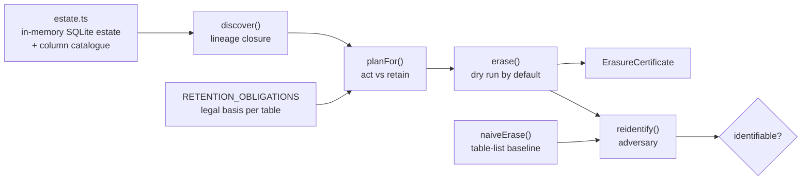

# erasure

GDPR erasure driven by column-level lineage, verified by an adversary that tries to re-identify the person you just deleted.

[](https://github.com/SlateGitOrg/erasure/actions/workflows/ci.yml)
[Live demo](https://slategitorg.github.io/erasure/)


## Why

A customer exercises their right to erasure and the team deletes them from the users table. Their data is still in the analytics warehouse, in exports, in the search index and in an "anonymous" cohort table that a postcode, a birth year and an order count can single out. The company is now non-compliant and believes it is compliant, which is the worse state because nobody is looking.

A hand-written list of tables to delete from is accurate on the day it is written and stale soon after, and it only ever covers direct identifiers. erasure discovers where a subject's data lives by following lineage, and then checks the result with an adversary instead of trusting it.

## Features

- Column catalogue with ground truth: which columns are PII, whether each is a direct identifier or a quasi-identifier, and which column it was derived from.
- Lineage discovery by transitive closure over `derivedFrom`, so new derived tables are found without editing a table list.
- Erasure planner and executor with **dry-run as the default**, producing a certificate of tables touched, rows affected and what was retained.
- Retention obligations recorded with the specific legal basis (for example Art. 21(3) GDPR for the email suppression list), not a boolean.
- A re-identification adversary that tries direct identifiers first and then singles the subject out on postcode + birth year + order count.
- A naive table-list eraser kept alongside, so the difference can be demonstrated side by side.
- A browser demo (`site/`) that runs a decision workflow over a JSON set of records, deployed to GitHub Pages.

## Architecture



`src/estate.ts` builds a SQLite estate that stands in for five kinds of store: OLTP tables, a warehouse dimension and a cohort aggregate, a search index, exported rows and an email suppression list. It also defines the column catalogue, including which columns derive from which. `src/erase.ts` walks that lineage graph to find every PII location, plans which tables to act on and which to retain, executes the erasure, and runs the adversary against what remains.

## Quick start

Requires Node.js 22.18 or newer (24 recommended). TypeScript runs through Node's built-in type stripping and the estate uses `node:sqlite`, so there is no install step, no build and no `node_modules`.

```bash
git clone https://github.com/SlateGitOrg/erasure.git
cd erasure
npm test        # 17 tests: 15 core, 2 for the browser demo
npm run demo    # naive erasure versus lineage-driven erasure, with the adversary
```

## Example

`npm run demo` seeds 200 synthetic subjects, picks one whose quasi-identifiers are unique, and runs both approaches. Trimmed output:

```text
  Lineage discovery: 16 PII columns across 5 stores

  ATTEMPT 1 - delete from the tables everyone remembers
    before: identifiable via customers (direct)
    after:  STILL IDENTIFIABLE via dw_customer_dim (direct)

  ATTEMPT 2 - lineage-driven erasure
    before: identifiable via customers (direct)
    after:  not identifiable

    tables erased:  customers, orders, dw_customer_dim, dw_cohort_metrics, search_documents, export_rows
    rows affected:  7
    retained:       email_suppression
                    Art. 21(3) GDPR - a suppression record is required to honour the objection itself; ...
```

In code:

```ts
import { createEstate, seed, makeSubjects } from './src/estate.ts';
import { erase, reidentify } from './src/erase.ts';

const subjects = makeSubjects(200);
const db = createEstate();
seed(db, subjects);

erase(db, subjects[0]!);                    // dry run: counts rows, deletes nothing
erase(db, subjects[0]!, { dryRun: false }); // deletes, returns the certificate
reidentify(db, subjects[0]!);               // { succeeded: false, via: null, matches: 0 }
```

## How it works

- **Lineage discovery.** `discover()` starts from the subject root table and repeatedly adds any column whose `derivedFrom` is in the current frontier, until nothing new appears. Each result records why it was found (`direct`, `lineage` or `quasi-identifier`) and how many hops from the root.
- **Quasi-identifiers count.** The aggregated `dw_cohort_metrics` table has no name or email, yet `(postcode, birth_year, order_count)` is unique for some people. It is catalogued as PII and erased by that triple, which a direct-identifier table list never touches.
- **Retention is explicit.** The suppression list is kept because deleting it would resume the marketing the person objected to. The plan separates `act` from `retain`, and the certificate carries the legal basis for each retained table.
- **The adversary must have power.** It is asserted to succeed before erasure as well as fail after. Without that, a clean result after erasure would be indistinguishable from an erasure that did nothing.
- **Recall is measured against planted truth.** `PLANTED_LOCATIONS` lists every table the subject's data genuinely reaches, and discovery must cover all of them.
- **Idempotent and isolated.** Re-running an erasure changes nothing further, and erasing one subject leaves other subjects intact.

See [docs/ARCHITECTURE.md](docs/ARCHITECTURE.md) for the decisions, failure modes and scope.

## Testing

```bash
npm test                         # tests/recall.test.ts and site/core.test.mjs
node --test tests/recall.test.ts # the core suite only
```

`tests/recall.test.ts` covers: 100% discovery recall against planted locations; the cohort table found through lineage; non-PII columns not swept up; the adversary succeeding before erasure and failing after; the naive erasure leaving the subject identifiable; a crowded cohort not singling anyone out; dry-run default; the certificate contents; isolation between subjects; idempotence; and retention with its legal basis. `site/core.test.mjs` checks the browser demo's decision contract. CI additionally runs `scripts/validate_site.py`.

## Project layout

```text
src/
  estate.ts        multi-store SQLite estate, column catalogue, seed data
  erase.ts         discovery, planner, erasure, adversary, naive baseline
  demo.ts          npm run demo
tests/recall.test.ts
site/              browser demo deployed to GitHub Pages
scripts/validate_site.py
docs/ARCHITECTURE.md
.github/workflows/ci.yml
```

## Limitations

- The estate is a single in-memory SQLite database that models the stores; it does not connect to PostgreSQL, a warehouse, OpenSearch or object storage.
- The lineage catalogue is declared in code rather than extracted from SQL or OpenLineage events, and columns are not classified automatically.
- Backups and other offline copies are not handled; a restore can reintroduce erased data.
- The adversary checks the direct identifiers and one quasi-identifier combination, which is a small slice of real re-identification risk.
- Not legal advice and not a compliance certification. It is an engineering control beneath a policy.

## License

MIT — see [LICENSE](LICENSE).
