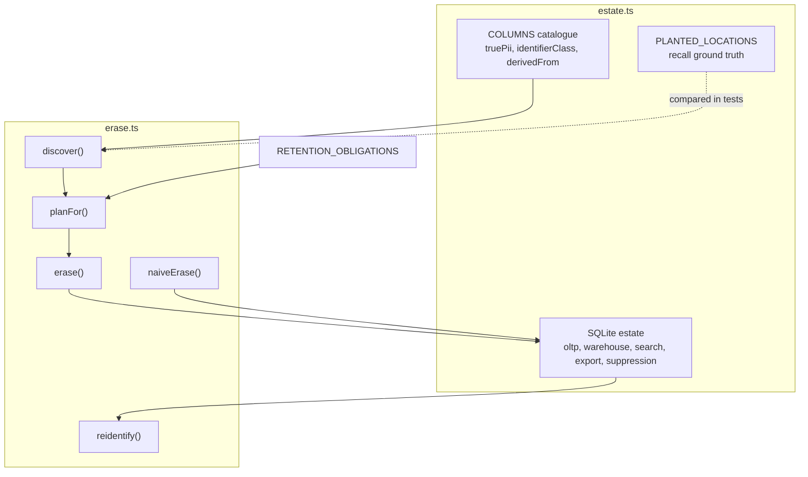

# Architecture

## Context

Erasure requests are usually implemented as a list of tables to delete from. That list reflects what someone remembered when they wrote it, so copies made later in the warehouse, in exports or in search indexes are missed, and nothing reports that. erasure derives the list from lineage and then tests the outcome.

## Components

The estate is an in-memory SQLite database (`node:sqlite`) with one table per kind of store. The column catalogue is the source of truth for lineage: each derived column names the column it came from.

## Key decisions

**Discovery follows lineage, not a table list.** `discover()` computes a transitive closure over `derivedFrom`, bounded to ten hops. Adding a derived column to the catalogue makes it discoverable without touching the erasure code. The alternative, a static list, is simpler but is stale as soon as the schema changes.

**Quasi-identifiers are in scope.** The cohort aggregate has no direct identifier, yet postcode, birth year and order count can single out a person. It is classified as PII and erased by that combination. The trade-off is that erasing a row by quasi-identifiers can remove the aggregate for other people who share the combination; the adversary only treats a combination as identifying when it matches exactly one row.

**Dry run is the default.** `erase()` counts affected rows and builds the certificate without deleting anything unless `dryRun: false` is passed.

**Retention is recorded with its basis.** `RETENTION_OBLIGATIONS` maps a table to the specific obligation that requires keeping it. The plan splits tables into `act` and `retain`, and the certificate lists the retained tables with that basis so the decision can be audited.

**The adversary is validated, not assumed.** The tests require it to succeed before erasure. A check that only ever reports success after erasure would also pass on an adversary that never worked.

## Failure modes

- A column missing from the catalogue is invisible to lineage. Recall is measured against `PLANTED_LOCATIONS` so a gap shows up as a failing test, but only for locations that were planted.
- The primary key is itself an identifier. Leaving it out of the catalogue hides every foreign key that references it, so the order history would never be discovered.
- Re-running an erasure is safe: tables with no matching rows are skipped and the second certificate reports zero rows.

## Out of scope

- Connecting to real databases, warehouses, search clusters or object stores.
- Extracting lineage from SQL or OpenLineage events, and automatic PII classification.
- Backups and restore-time re-introduction of erased data.
- Legal determinations. Retention bases are examples, not advice.
